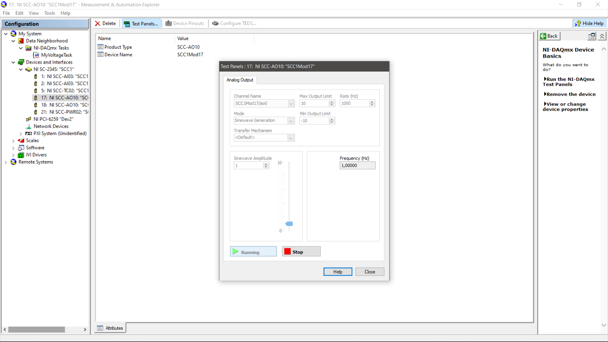
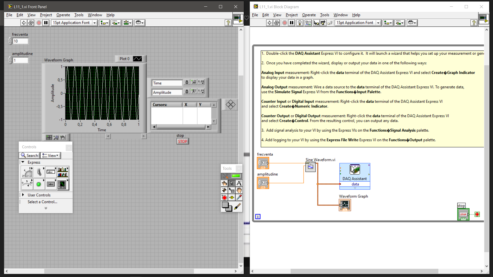
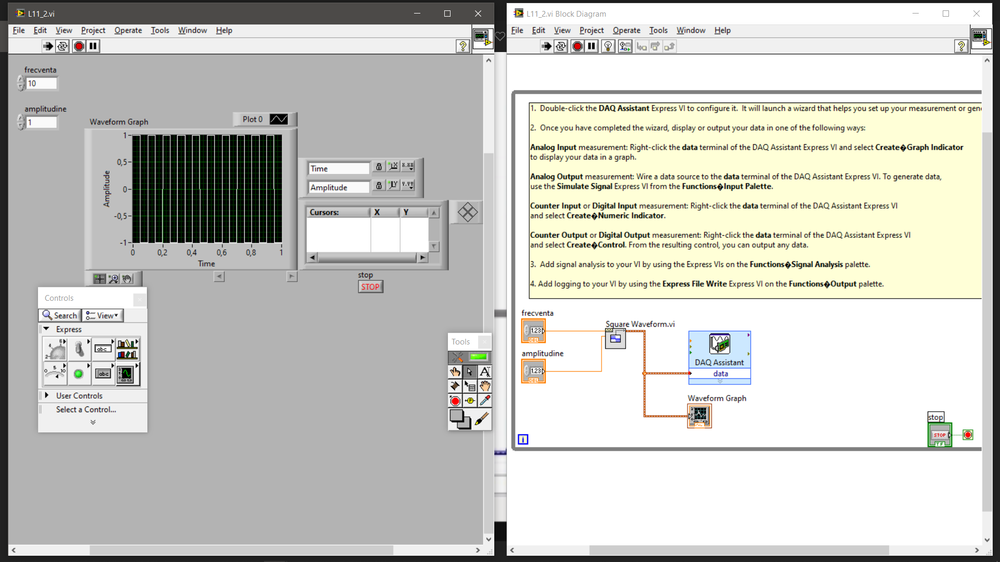

# Generarea Semnalelor Analogice cu LabVIEW
**Analog Signal Generation using LabVIEW**

---

## 🇷🇴 Română

### Descriere

Acest proiect prezintă implementarea unui sistem de generare a semnalelor analogice folosind **LabVIEW** și driverul **NI-DAQmx**, împreună cu hardware compatibil National Instruments.

Proiectul urmărește configurarea unui dispozitiv de achiziție și generare de date, configurarea canalelor de ieșire analogică și generarea diferitelor forme de undă, precum semnale sinusoidale și dreptunghiulare.

Implementarea utilizează instrumente virtuale LabVIEW (VI), iar configurarea hardware și operațiile de generare sunt documentate prin capturi de ecran.

## Obiective

- Configurarea unui dispozitiv National Instruments folosind NI Measurement & Automation Explorer (NI MAX).
- Familiarizarea cu driverul NI-DAQmx și funcționalitățile acestuia.
- Configurarea canalelor de ieșire analogică.
- Generarea semnalelor analogice utilizând LabVIEW.
- Implementarea și observarea diferitelor forme de undă.
- Utilizarea interfeței grafice LabVIEW pentru configurarea și monitorizarea parametrilor.

## Funcționalități

- Configurarea dispozitivului hardware și a canalelor de ieșire.
- Utilizarea NI-DAQmx pentru controlul operațiilor de intrare/ieșire.
- Configurarea operațiilor prin DAQ Assistant.
- Generarea semnalelor sinusoidale și dreptunghiulare.
- Configurarea parametrilor semnalelor, precum amplitudinea și frecvența, acolo unde sunt implementați.
- Reprezentarea grafică a semnalelor generate.
- Utilizarea panoului frontal (Front Panel) și a diagramei bloc (Block Diagram) din LabVIEW.

## Tehnologii și instrumente utilizate

- **LabVIEW** – dezvoltarea aplicației și implementarea instrumentelor virtuale.
- **NI-DAQmx** – configurarea și controlul dispozitivelor National Instruments.
- **NI MAX** – identificarea și configurarea hardware-ului.
- **DAQ Assistant** – configurarea operațiilor de achiziție și generare a semnalelor.

## Structura proiectului

```text
Generarea-Semnalelor-Analogice-LabVIEW/
├── L11_1.vi
├── L11_2.vi
├── L11_3.vi
├── README.md
├── Images/
│   ├── configurare-hardware-ni-daqmx.png
│   ├── generare-semnale-sinusoidale.png
│   └── generare-semnale-dreptunghiulare.png
└── documentatie/
    ├── documentatie.docx
    └── documentatie.pdf
```

## Cerințe

- LabVIEW instalat.
- Driver NI-DAQmx instalat și configurat.
- Dispozitiv National Instruments compatibil cu generarea de tensiune analogică, pentru testarea pe hardware real.

## Mod de utilizare

1. Instalați LabVIEW și driverul NI-DAQmx.
2. Conectați dispozitivul National Instruments.
3. Verificați dacă dispozitivul este recunoscut în NI MAX.
4. Deschideți unul dintre fișierele VI în LabVIEW.
5. Verificați configurarea dispozitivului și a canalului de ieșire analogică.
6. Configurați parametrii semnalului, în funcție de funcționalitățile VI-ului.
7. Rulați aplicația și observați semnalul generat.

## Capturi de ecran

### 1. Configurarea dispozitivului în NI MAX



### 2. Generare semnal sinusoidal



### 3. Generare semnal dreptunghiular



---

# 🇬🇧 English

## Overview

This project demonstrates the implementation of an analog signal generation system using **LabVIEW** and the **NI-DAQmx** driver, together with compatible National Instruments hardware.

The project focuses on configuring a data acquisition and generation device, setting up analog output channels, and generating different waveform types, including sine and square signals.

The implementation uses LabVIEW Virtual Instruments (VIs), while hardware configuration and signal generation procedures are documented through screenshots.

## Objectives

- Configure a National Instruments device using NI Measurement & Automation Explorer (NI MAX).
- Understand and use NI-DAQmx driver functionality.
- Configure analog output channels.
- Generate analog signals using LabVIEW.
- Implement and observe different waveform types.
- Use the LabVIEW graphical interface to configure and monitor signal parameters.

## Features

- Hardware device and analog output channel configuration.
- NI-DAQmx integration for hardware input/output operations.
- DAQ Assistant configuration.
- Sine and square waveform generation.
- Signal parameter configuration, including amplitude and frequency, where implemented.
- Graphical representation of generated signals.
- LabVIEW Front Panel and Block Diagram implementation.

## Technologies and Tools

- **LabVIEW** – application development and Virtual Instrument implementation.
- **NI-DAQmx** – configuration and control of National Instruments devices.
- **NI MAX** – hardware identification and configuration.
- **DAQ Assistant** – configuration of data acquisition and signal generation operations.

## Project Structure

```text
Generarea-Semnalelor-Analogice-LabVIEW/
├── L11_1.vi
├── L11_2.vi
├── L11_3.vi
├── README.md
├── Images/
│   ├── configurare-hardware-ni-daqmx.png
│   ├── generare-semnale-sinusoidale.png
│   └── generare-semnale-dreptunghiulare.png
└── documentatie/
    ├── documentatie.docx
    └── documentatie.pdf
```

## Requirements

- LabVIEW installed.
- NI-DAQmx driver installed and configured.
- A National Instruments device supporting analog voltage generation for physical hardware testing.

## How to Run

1. Install LabVIEW and the NI-DAQmx driver.
2. Connect the National Instruments device.
3. Verify that the device is recognized in NI MAX.
4. Open one of the VI files in LabVIEW.
5. Check the device and analog output channel configuration.
6. Configure the signal parameters according to the VI functionality.
7. Run the application and observe the generated waveform.

## Screenshots

### 1. Device Configuration in NI MAX


### 2. Sine wave generation


### 3. Square wave generation


---

## 👤 Autor / Author

**IonutD**
